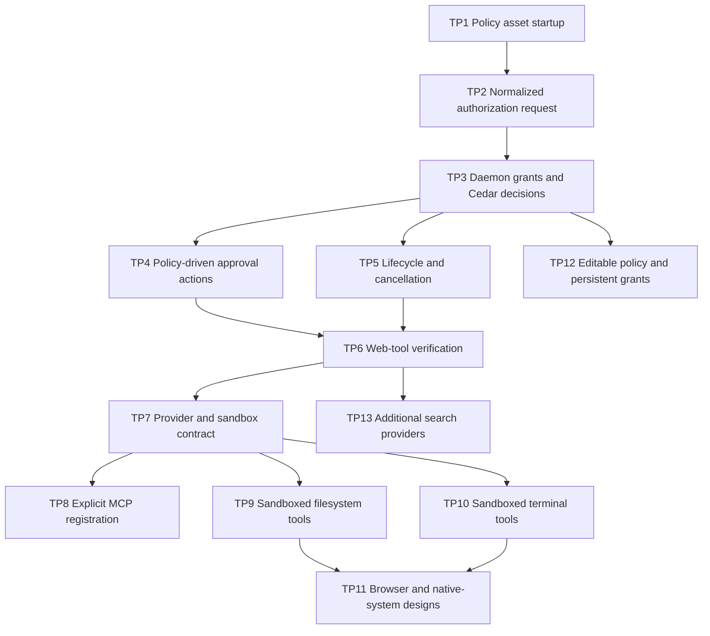

# Tool-platform closeout and next phase

## Purpose

This plan closes the incomplete authorization work for the current web tools.
It then adds the next tool-platform capabilities in narrow increments. The
Daemon must own authorization before Nook adds a tool that can read local data,
run a process, or control another application.

## Current state

The Worker exposes `nook:web_search` and `nook:web_fetch`. Tool metadata lives
in `policy/tools.yaml`. Cedar schema and policy files live in `policy/cedar/`.
`CedarAuthorizer` can validate Cedar files and evaluate in-memory scoped grants.

The running Daemon does not load `policy/tools.yaml`, Cedar schema, or Cedar
policy during startup. The Daemon does not yet make the final authorization
decision for every active tool request. The Worker retains approval behavior
that must move behind the Daemon boundary.

## Scope

The plan has two stages.

1. Close the current policy and approval implementation for web search and
   web fetch.
2. Design and add future tool providers without weakening that boundary.

MCP discovery and installation, terminal execution, filesystem access, browser
automation, and native-system tools are separate delivery increments. Nook does
not add them together.

## Stage 1: Close the current tool boundary

### TP1. Load and validate policy assets at Daemon startup

The Daemon loads `policy/tools.yaml`, the Cedar schema, and Cedar policy files
from the installed bundle or the development checkout. It rejects invalid,
missing, or incompatible assets before accepting tool requests.

Done when:

- The Daemon starts with valid assets.
- Invalid YAML, Cedar schema, or Cedar policy stops tool startup.
- Tests cover installed-resource and development-resource lookup.

### TP2. Define one normalized authorization request

Define one request type that carries the chat identifier, tool name, validated
arguments, normalized target, approval tier, and argument digest. The Worker
validates tool arguments before sending this request to the Daemon.

Done when:

- Built-in tools use the same normalized request shape.
- The Daemon owns argument-digest and host normalization rules.
- Invalid arguments do not reach Cedar or an executor.

### TP3. Move grants and decisions to the Daemon

Store pending approvals and scoped grants in the Daemon. The Daemon evaluates
Cedar before approval, records a scoped grant after an allowed decision, and
evaluates Cedar again before it permits execution.

Done when:

- The Worker cannot run a tool without a Daemon allow result.
- An exact grant cannot authorize another argument set.
- A host grant cannot authorize another host.
- Worker restart does not remove a Daemon-owned grant.

### TP4. Make approval actions policy-driven

Load the approval actions and tool display metadata from `policy/tools.yaml`.
The Daemon forwards only allowed actions to the Panel. The Panel renders the
provided actions and their scope descriptions.

Done when:

- Changing approved metadata changes the rendered approval card after restart.
- YAML cannot permit a request Cedar denies.
- Invalid actions fail startup.

### TP5. Complete tool lifecycle events and cancellation

Record each active tool call and connect approval, deny, cancellation, and
resume behavior to the original request. Escape cancels the pending request and
prevents a later decision from resuming it.

Done when:

- The Panel shows tool start and finish state for a live tool request.
- Deny returns a rejected result to the model without running the executor.
- Escape ends the reply as cancelled.
- A second request cannot receive events from a cancelled request.

### TP6. Verify the complete web-tool path

Add deterministic tests for policy startup, normalized facts, Cedar decisions,
grant scopes, approval actions, cancellation, DuckDuckGo-only search, and fetch
network guards. Run the packaged desktop test path against the built runtime.

Done when:

- Every active tool request reaches Cedar before execution.
- A denied request never reaches an executor.
- Package and native desktop checks cover an approval request and a resumed
  reply.

## Stage 2: Extend the tool platform

### TP7. Define the provider and sandbox contract

Define provider registration, tool identity, schema validation, lifecycle,
resource limits, cancellation, logging, and failure messages. Select a sandbox
implementation before terminal or filesystem access is exposed.

The design must define filesystem roots, network access, environment filtering,
timeouts, output limits, cleanup, and how a tool result returns to the Worker.
A new ADR records the selected sandbox implementation and any Cedar boundary
change.

Done when:

- A design review approves the provider and sandbox contract.
- A prototype proves the selected sandbox can enforce the stated boundary.
- The decision record names the selected implementation and rejected options.

### TP8. Add explicit MCP server registration

Add a configuration path for an explicitly named MCP server. Validate server
metadata, tool schemas, name collisions, lifecycle failures, and unavailable
servers. Route every MCP call through the normalized Daemon authorization
request.

Public discovery and installation are not in this increment.

Done when:

- A configured server can expose validated tools.
- An invalid server or schema does not expose a tool.
- Cedar denial prevents an MCP call.

### TP9. Add sandboxed filesystem tools

Add read and write tools with configured root directories, normalized paths,
symlink policy, overwrite behavior, size limits, and structured arguments.

Done when:

- A tool cannot access paths outside an approved root.
- A grant for one path does not authorize a different path.
- Tests cover traversal, symlink escape, cancellation, and denied writes.

### TP10. Add sandboxed terminal tools

Add structured command execution with a fixed working directory, filtered
environment, executable policy, timeout, output limits, and cancellation.

Done when:

- The sandbox blocks unapproved filesystem and network access.
- The Daemon authorizes each command request before execution.
- Tests cover timeout, output truncation, cancellation, and denial.

### TP11. Add browser and native-system capability designs

Define browser automation and native-system capabilities separately. Each
proposal identifies platform support, credential and cookie handling, download
rules, user-visible approval content, isolation, and tests.

Done when:

- Each capability has an approved design before implementation starts.
- The design names unsupported platforms and failure behavior.

### TP12. Add editable policy and persistent grants

Allow users to edit validated policy preferences and persistent grants without
bypassing Cedar. The Daemon validates a proposed change and shows its effective
scope before applying it.

Done when:

- Invalid policy changes do not apply.
- Persistent grants have visible scope and revocation controls.
- The effective Cedar decision remains the final authorization result.

### TP13. Add additional search providers

Add image, news, video, and book search one provider type at a time. Each tool
uses a structured result model, explicit provider configuration, policy
metadata, and denial tests.

Done when:

- Each new search tool passes the same authorization and content-trust tests as
  the existing web tools.

## Dependencies

## Delivery gates

The first release gate is TP6. Nook does not add a tool that can access local
files, execute a command, automate a browser, or call a native API before TP7
and the relevant sandbox tests pass.

## Documentation changes

When TP6 completes, update `tools-and-authorization.md`, `contracts.md`, and
`CHECKLIST.md`. When TP7 selects a sandbox implementation, add a new ADR rather
than editing ADR 0004. Each later tool increment updates its public tool
metadata, policy reference, contract examples, and tests in the same change.
